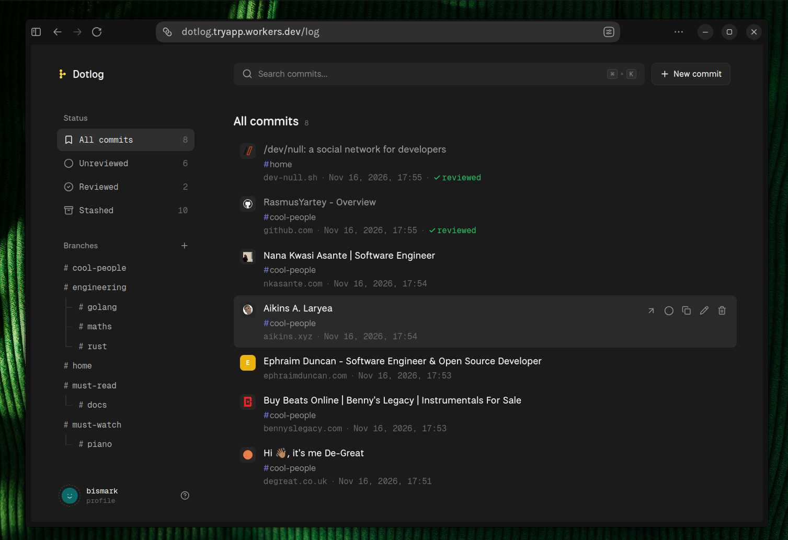

# Dotlog

[dotlog.tryapp.workers.dev](https://dotlog.tryapp.workers.dev)

An open-source bookmark manager for developers who like things organized.
Save links as commits, organize them into branches, and stop losing them in 40 open tabs.

#### Why you'll like it

- Keyboard-driven, so you can do most things without touching the mouse
- Saved links are encrypted in the browser. The server only stores ciphertext.
- Sign in with your password, confirmed by a code sent to your email
- Open source and easy to self-host on Cloudflare Workers

#### Terms

Read the [Terms](https://dotlog.tryapp.workers.dev/terms) before using the
hosted app. If you don't agree with them, you can host your own copy. See
[SELF-HOSTING.md](SELF-HOSTING.md).

#### Contributing

Contributions are welcome. Open an issue or a pull request. For security problems, please follow [SECURITY.md](SECURITY.md).

